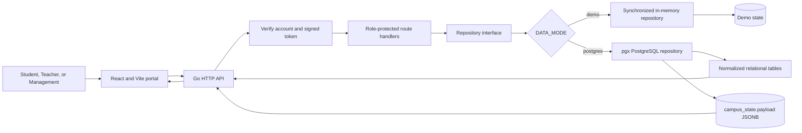
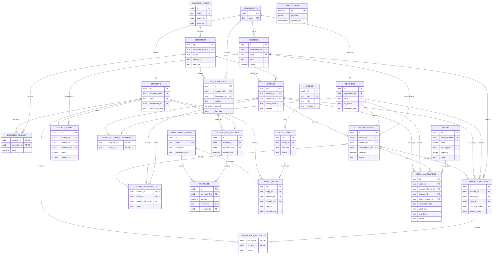

# Myriad Technical College — Database Architecture Report

## Executive summary

The project has a Supabase-compatible PostgreSQL schema in the `public` database schema. It contains 24 tables, foreign keys, unique and check constraints, workload indexes, and a trigger that prevents overlapping active room allocations. The backend supplies UUIDs, so the setup needs no PostgreSQL extension.

The database design is stronger than a single flat table or frontend-only mock data because it models academic relationships explicitly, enforces important invariants in PostgreSQL, and protects attendance and room writes with transactions. The current application is still a hybrid: attendance sessions, offerings, enrollments, accounts, rooms, and allocations use relational tables, while older attendance summaries, marks, fees, notices, and library data use one JSONB snapshot. Several normalized tables are defined but are not yet used by API repository code. This distinction is called out throughout the report.

## Database request and persistence flow

The browser never connects to PostgreSQL. It calls the Go API. The Go repository selected by `DATA_MODE` determines whether data is held in memory or in PostgreSQL.

### Which features use which storage path

| Feature | Current PostgreSQL storage | Implementation status |
|---|---|---|
| Account login and profile | `students`, `teachers`, `management_users`, `departments` | Relational queries; Go verifies bcrypt hashes. |
| Course list and roster | `course_offerings`, `courses`, `classes`, `student_enrollments` | Relational joins and active enrollment counts; roster is not paginated. |
| Session attendance | `attendance_sessions`, `attendance_records` | Relational transaction; validates every active enrolled student. |
| Room availability and allocations | `rooms`, `room_allocations`, related offering/course/class/teacher tables | Relational queries, transactions, indexes, and overlap trigger. |
| Summary attendance and marks | `campus_state.payload` | Aggregate JSON arrays keyed by course code; not per-student history. |
| Fees | `campus_state.payload` | One current fee summary; no payment API/ledger in the Go application. |
| Notices | `campus_state.payload` | Text notice list; file upload has no matching API route. |
| Library inventory and issues | `campus_state.payload` | Current Go CRUD uses arrays in JSONB, not the normalized library tables below. |

`teacher_course_assignments`, `subject_marks`, `semester_results`, the fee/payment tables, and the normalized library tables are defined in SQL but are not read or written by current Go operations. Their presence is useful as a future relational foundation, but they should not be presented as completed application workflows.

## Full ER model outline

Solid lines below represent foreign-key relationships in the SQL. `campus_state` is deliberately separate: its JSONB payload has no relational foreign keys. All 24 tables are shown; the entities noted above as not wired into current APIs remain schema-only today.

### Relationship notes

- **Academic chain:** one department has many students, teachers, and courses. A course belongs to many class sections over semesters. A class section is represented by `classes`; the schema does not have a separate `class_sections` table.
- **Teaching:** `course_offerings` joins one course, teacher, and class section for a term, and carries schedule, capacity, and active status. `teacher_course_assignments` also records teacher/class pairs, but current authorization reads `course_offerings.teacher_id` directly.
- **Enrollment:** `student_enrollments` is the student-to-class junction table. `course_offering_id` and `status` were added for offering-level roster selection and active/withdrawn/completed state. A composite primary key prevents duplicate student/class enrollment; a partial unique index prevents duplicate student/offering enrollment.
- **Attendance:** one session contains records keyed by `(session_id, student_id)`. Sessions reference the teacher, course, class, and optionally an offering for compatibility with legacy rows. The Go workflow uses the offering ID and validates all active enrollments.
- **Fees:** a fee structure defines a semester/optional department fee; per-student fee records reference it; payment rows record numeric amounts and management user attribution. These normalized tables are schema-only in the current app.
- **Library:** books have physical copies; issue rows connect a copy, student, and management user. A partial unique index allows at most one active issue per copy. These tables are schema-only in the current app.
- **Rooms:** each allocation connects one room, offering, teacher, and class section. Interval checks reject `end_time <= start_time`; the trigger prevents overlapping active claims for the same room, teacher, or offering.
- **JSONB snapshot:** `campus_state` is intentionally independent of the relational model and has one row (`id = 1`). Mutations lock that row before changing the JSON document.

## Schema inventory

All objects currently live in PostgreSQL's `public` schema. Logical groupings below are report headings, not separately created PostgreSQL schemas.

### Shared snapshot

| Table | Key columns | Current use |
|---|---|---|
| `campus_state` | `id smallint PK`, `payload jsonb`, `updated_at timestamptz` | Shared legacy application state; singleton row enforced by `CHECK (id = 1)`. |

### Identity and academic catalog

| Table | Key columns | Important constraints |
|---|---|---|
| `departments` | `id uuid PK`, `name text` | Department name unique. |
| `academic_years` | `id uuid PK`, `label`, `starts_on`, `ends_on` | Label unique; end after start. |
| `semesters` | `id uuid PK`, `academic_year_id FK`, `name`, dates | Unique year/name; end after start. |
| `management_users` | `id uuid PK`, `email`, `full_name`, `password_hash` | Email unique; bcrypt hash stored as text. |
| `teachers` | `id uuid PK`, `department_id FK`, `email`, `password_hash` | Email unique; department required. |
| `students` | `id uuid PK`, `student_number`, `email`, `department_id FK`, `password_hash` | Student number and email unique. |
| `courses` | `id uuid PK`, `department_id FK`, `code`, `title`, `credits` | Course code unique; credits positive. |
| `classes` | `id uuid PK`, `course_id FK`, `semester_id FK`, `class_name`, `section` | Unique course/semester/name/section. |
| `course_offerings` | `id uuid PK`, `course_id FK`, `teacher_id FK`, `class_section_id FK`, `capacity`, `schedule`, `status` | Positive capacity; active/inactive status; teacher/status index. |
| `student_enrollments` | `student_id FK`, `class_id FK`, `course_offering_id FK`, `status`, `enrolled_at` | Student/class PK; active status index; partial unique offering/student index. |
| `teacher_course_assignments` | `teacher_id FK`, `class_id FK` | Composite PK prevents duplicate assignments. |

### Attendance and academic results

| Table | Key columns | Important constraints |
|---|---|---|
| `attendance_sessions` | `id uuid PK`, teacher/course/class/offering FKs, `session_date`, `starts_at` | Unique class/date/time and partial unique offering/date/time indexes. |
| `attendance_records` | `session_id FK`, `student_id FK`, `status`, `remarks` | Composite session/student PK; status in present/absent/late/excused; student/session index; deleting a session cascades to its rows. |
| `subject_marks` | `id uuid PK`, student/course/semester FKs, `assessment`, `marks`, `maximum`, `grade` | Numeric marks; marks within maximum; unique student/course/semester/assessment. |
| `semester_results` | student/semester composite PK, `sgpa`, `published_at` | SGPA constrained to 0–10. |

### Fees and payments

| Table | Key columns | Important constraints |
|---|---|---|
| `fee_structures` | `id uuid PK`, semester FK, optional department FK, category, `amount numeric(12,2)`, due date | Allowed fee categories; nonnegative amount. |
| `student_fee_records` | `id uuid PK`, student/fee-structure FKs, `amount_due numeric(12,2)` | Unique student/fee-structure; nonnegative amount. |
| `payments` | `id uuid PK`, fee-record FK, amount, reference, status, management user FK | Positive numeric amount; unique reference; recorded/voided status; fee-record/date index. |

### Library

| Table | Key columns | Important constraints |
|---|---|---|
| `books` | `id uuid PK`, optional `isbn`, title, author, publisher, category | ISBN unique when present. |
| `book_copies` | `id uuid PK`, `book_id FK`, barcode, status | Barcode unique; available/issued/maintenance status. |
| `library_issues` | `id uuid PK`, copy/student/management FKs, issued/due/returned dates | Due/return date checks; partial unique active issue per copy; student history index. |

### Rooms

| Table | Key columns | Important constraints |
|---|---|---|
| `rooms` | `id uuid PK`, room number, building, floor, type, capacity, status | Unique room number; allowed room types/statuses; positive capacity. |
| `room_allocations` | `id uuid PK`, room/offering/teacher/class FKs, date, time interval, status, claimed/released timestamps | End after start; released timestamp required only for RELEASED; active interval indexes; overlap trigger. |

## Why this structure is stronger

1. **Database-enforced integrity:** foreign keys, composite primary keys, unique indexes, status checks, positive capacities, numeric ranges, and date/time checks catch invalid writes even when a client bypasses the UI.
2. **Clear academic relationships:** courses remain catalog records; `classes` identify term sections; `course_offerings` connect a course/teacher/section; enrollments connect students to sections and offerings. That is more maintainable than storing rosters in frontend arrays.
3. **Attendance is a history, not a counter:** sessions and per-student records preserve who was marked present/absent/late/excused in each class meeting. The current Go path submits the full active roster transactionally.
4. **Room claims are concurrency-aware:** the database trigger locks the room row and rejects overlap for the room, teacher, and offering. The API also performs transactional conflict checks, so the UI availability result is not the only protection.
5. **Financial values avoid floating point:** the dormant fee/payment schema uses `numeric(12,2)` amounts, while marks use `numeric(6,2)`. This is suitable for exact decimal storage.
6. **Supabase-friendly setup:** IDs are supplied by Go; no extension or Supabase Auth dependency is required. The frontend only calls the API, and no anon/authenticated grants or RLS policies are added by these files.
7. **Incremental migration path:** the JSONB snapshot keeps older endpoints running while their repositories are migrated to normalized tables feature by feature.

These are strengths of the schema design. They do not mean every table is active in the application today; the snapshot-backed modules still need repository migration and user-level ownership before production use.

## Transaction flow: full-roster attendance

```mermaid
flowchart LR
  teacher["Teacher selects assigned offering"] --> roster["Load all active enrollments"]
  roster --> mark["Set one valid status per student"]
  mark --> submit["Submit complete session"]
  submit --> tx["Begin serializable transaction"]
  tx --> lockOffering["Lock and verify offering ownership"]
  lockOffering --> validate["Re-read roster and validate exact student set"]
  validate --> saveSession["Insert or update session"]
  saveSession --> replaceRows["Replace attendance rows in transaction"]
  replaceRows --> commit["Commit or roll back all writes"]
  commit --> response["Return saved session"]
```

## Transaction flow: room claim and release

```mermaid
flowchart LR
  teacher["Teacher chooses offering, room, date, and interval"] --> check["Availability query filters maintenance, capacity, overlap"]
  check --> claim["Claim request reaches Go API"]
  claim --> tx["Begin serializable transaction"]
  tx --> verify["Verify teacher owns active offering"]
  verify --> roomLock["Lock room row and check maintenance/capacity"]
  roomLock --> conflicts["Check room, teacher, and offering conflicts"]
  conflicts --> trigger["Database trigger repeats overlap guard"]
  trigger --> save["Insert ACTIVE allocation and mark room occupied"]
  save --> commit["Commit claim"]
  commit --> release["Owner releases allocation later"]
  release --> releaseTx["Lock allocation, mark RELEASED, timestamp it"]
  releaseTx --> free["Make room available when no active claim remains"]
```

## SQL object and workflow verification

The setup is split into ordered files and duplicated in one SQL Editor-ready script:

- Schema migrations: [`001_initial.sql`](../backend/migrations/001_initial.sql), then [`002_attendance_rooms.sql`](../backend/migrations/002_attendance_rooms.sql).
- Development-only users and realistic sample rows: [`demo.sql`](../backend/seeds/demo.sql).
- Object, index, seed, hash, enrollment, and overlap checks: [`verify_supabase.sql`](../backend/verification/verify_supabase.sql).
- Consolidated SQL Editor script: [`supabase_setup.sql`](../backend/supabase_setup.sql).

The migrations, seed, and consolidated script were applied to a temporary local PostgreSQL 18.6 database. Verification showed 24 tables, 24 active offering enrollments, six students, four offerings, two sessions with 12 records, 24 rooms, two allocation-history entries, unique seed salts, and no overlapping active allocations. The Go repository integration smoke test passed on the seeded database. A live Supabase project was not available for verification.

## Limits and next improvements

- Move summary attendance/marks, fees, notices, and library operations from `campus_state` to their normalized tables, preserving current API DTOs while adding per-student ownership.
- Add payment posting and reversal operations with transactions; the current fee screen only edits an aggregate fee summary.
- Wire `subject_marks` and `semester_results` into repository methods, or remove unused schema tables only through a planned migration.
- Use `teacher_course_assignments` consistently or document `course_offerings.teacher_id` as the authoritative assignment source.
- Add explicit APIs for account provisioning and password reset; no signup/reset route currently exists.
- Add PostgreSQL integration tests to CI and test concurrency with two simultaneous room claims.
